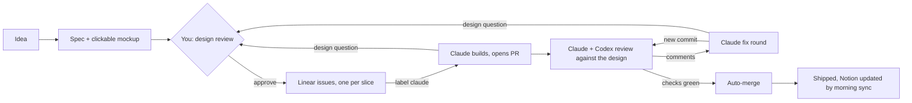

# idea-to-pr-loop

A template for running product work as a loop where your review happens early. Every feature, big or small, starts as a spec with a clickable mockup. You approve the two together, once, and Claude builds, reviews, fixes and merges the code. You never need to read a PR. ChatGPT Codex gives every PR a second, independent review.

It is a set of GitHub Actions workflows, a CLAUDE.md template, setup notes for Notion and Linear, and prompts for two scheduled Claude tasks. It is not a service: nothing runs outside your GitHub, Notion, Linear and Claude accounts.

## The loop

<!-- loop:idea -->
### Start with an idea

Everything starts here, and it is the easiest step. Open a Claude chat, on your phone or computer, and talk the idea through. Voice works well: say it the way you would explain it to a colleague, walking or driving. Claude asks questions until the idea is clear, then saves it to the Notion Ideas database. When you are happy with it, set it to Spec it. That one change starts the loop.

- **Actors:** You, Claude
- **What Claude helps you sharpen:**
  - The problem: what is wrong or missing today, in one or two sentences.
  - Who it is for: the people who will use it, and what they do now instead.
  - Why now: what makes it worth building this week rather than later.
  - Size and repo: small, medium or large, and which product it belongs to.
- **Try saying:** "I want a page that explains our workflow to colleagues and helps them set it up. Ask me what you need, then save it as an idea in Notion."
<!-- /loop:idea -->

### The steps

<!-- loop:steps -->
2. **Spec and mockup** (Claude, Notion): Once you set the idea to Spec it, Claude writes the spec and makes a clickable mockup ([prompts/spec-and-mockup.md](prompts/spec-and-mockup.md)). A feature with no screen gets a preview of the behavior instead. Bug fixes that only restore approved behavior skip this.
3. **Design review** (You, Notion): You open the mockup, ask for changes and approve. This is the only review you do.
4. **Linear issues** (Claude, Linear, GitHub): Claude cuts the spec into small slices, each with acceptance criteria, the mockup link and a Design section, and opens a matching GitHub issue labelled `claude` (or Linear's sync does).
5. **Build** (Claude, GitHub): A GitHub Action (`claude.yml`) builds the issue on its own branch, named after the Linear ID, and opens a pull request. Nothing is built without an approved mockup, except a bug-fix that restores approved behavior.
6. **Two reviews** (Claude, ChatGPT, GitHub): Claude (`claude-review.yml`) reviews every pull request against the design. ChatGPT Codex gives a second, independent review through its own GitHub app.
7. **Fix rounds** (Claude, GitHub): `claude-fix.yml` fixes what it agrees with and replies with a reason where it does not. Security threads need a second Claude check before they close. One round per commit, at most three, then one fresh second attempt.
8. **Merge gate** (GitHub, Cloudflare): The `Merge gate` status (posted by the review and fix jobs with `scripts/merge-gate.sh`) stays red while a design question is open, a review thread is unresolved, the latest Claude review isn't "ready to merge", or the Codex review hasn't finished (set the repository variable `CODEX_REVIEW=off` if the repo has no Codex app). It is a required check, and GitHub auto-merge merges the pull request once it and `check` pass. The merge deploys to Cloudflare.
9. **Report** (Claude, Notion): A morning task updates each spec in Notion, and a weekly task writes a retro.
<!-- /loop:steps -->

### What still comes back to you

Only questions that need your judgment, and they come back to the spec's Design review, never as a PR to read. Name hard-to-undo steps in the spec and your approval covers them.

<!-- loop:comes-back -->
- **It can't be built as approved:** The design or acceptance criteria are impossible, clash with another feature, or need a scope change. A second attempt that also runs out of fix rounds comes back as this kind: the slice was cut wrong.
- **A security fix changes behavior:** A fix would change what people see or do. Other security findings close only when a second Claude check agrees.
- **A hard-to-undo step:** Deleting data, secrets, DNS or hosting settings, payments, launch switches.
<!-- /loop:comes-back -->

## What's in here

| Path | What it is |
|---|---|
| `.github/workflows/claude.yml` | Builds `claude`-labelled issues with an approved mockup into PRs and turns on auto-merge; answers `@claude` mentions |
| `.github/workflows/claude-review.yml` | Claude review against the design on each ready PR and push, ending in a verdict |
| `.github/workflows/claude-fix.yml` | Fix rounds after each review, the second security check, the second attempt and design questions |
| `.github/workflows/merge-gate.yml` | Updates the Merge gate when you remove `needs-human`, or on a manual re-run |
| `scripts/merge-gate.sh` | The Merge gate's checks, posted as a commit status |
| `.github/workflows/ci.yml` | Sample CI with a job named `check` |
| `scripts/check.sh` | Your install, lint, typecheck and test commands (fill this in) |
| `.github/workflows/site-dispatch.yml` | On every push to main, tells the site repo the template changed (needs `SITE_DISPATCH_TOKEN` and `SITE_REPO`; skips without them). See [docs/site-markers.md](docs/site-markers.md) |
| `CLAUDE.md.template` | Rules Claude follows in the repo |
| `docs/` | Setup for Notion, Linear, GitHub, and the options |
| `prompts/` | Spec-and-mockup prompt, new-project prompt, morning sync, weekly retro |
| `setup/` | Scripts for the repo settings (token secret, labels, ruleset, auto-merge) and the settings checklist. Run them from this template; don't copy them into your repo |

## Setup checklist

A new user can paste the starter prompt in [prompts/get-started.md](prompts/get-started.md) into a Claude chat, and Claude walks through these steps one at a time. Each step lists its account, what it does, and where to go.

<!-- loop:setup -->
1. **Start with Claude** (account: Claude): Sign up for a Claude plan that includes Claude Code. Every build, review and fix runs on this subscription, so no API key is needed.
   - More: Pick a plan with Claude Code. Several repos building at once may need a higher plan.
   - More: Install the Claude desktop app or Claude Code so you can run `claude setup-token` later.
   - More: Paste the starter prompt ([prompts/get-started.md](prompts/get-started.md)) into a new chat. Claude walks you through every step below.
   - Link: https://claude.ai
2. **Create a GitHub account and repo** (account: GitHub): The loop runs as GitHub Actions in your repo. Install the GitHub CLI and sign in as an admin of the repo.
   - Command: `gh auth login`
   - More: One repo per product.
   - More: You also need `jq` for the setup scripts.
   - Link: https://github.com/signup
3. **Connect Claude to the repo** (account: Claude GitHub app): Install the Claude GitHub app on the repo, then store your subscription token as a repo secret. The script asks for the token once and never shows it.
   - Command: `claude setup-token` then `bash setup/set-token.sh OWNER/REPO`
   - More: The secret is named `CLAUDE_CODE_OAUTH_TOKEN`.
   - Link: https://github.com/apps/claude
4. **Add the Codex review** (account: ChatGPT): Use a ChatGPT plan that includes Codex code review. Install the ChatGPT Codex Connector on the repo and turn on Automatic review.
   - More: The Merge gate waits for the Codex review to finish on every pull request.
   - Link: https://chatgpt.com
5. **Set up Notion** (account: Notion): Create the four databases (Ideas, Specs, Decisions, Retros) and the home page ([docs/notion.md](docs/notion.md)). Then connect Notion to Claude so it can write specs and the morning report.
   - More: Specs move through Drafting, Design review, Design approved, Building and Shipped.
   - More: Each spec has a Mockup link and a Design approved date.
   - Link: https://www.notion.com
6. **Set up Linear** (account: Linear): Create a team with the labels `claude`, `needs-human` and `bug-fix`, and install the Linear GitHub app ([docs/linear.md](docs/linear.md)). Connect Linear to Claude so it can cut issues.
   - More: Leave GitHub Issues sync off. Claude opens each GitHub issue with a Linear line on top.
   - More: Pull requests start with "Fixes ABC-12", so Linear links and closes the issue.
   - Link: https://linear.app
7. **Set up Cloudflare** (account: Cloudflare): Cloudflare runs what the loop ships: your domain, site, server code, database and files. Create an account, add your domain, and make one API token the deploy workflow can use.
   - More: Add your domain and switch its nameservers to Cloudflare.
   - More: Create a custom API token limited to your account and the products you use (Pages, Workers, D1, R2). Give it an expiry date.
   - More: Store it as the repo secret `CLOUDFLARE_API_TOKEN`, and your account ID as the repo variable `CLOUDFLARE_ACCOUNT_ID`.
   - More: Turn on the Cloudflare connector in Claude so it can check deploys, databases and logs.
   - Link: https://dash.cloudflare.com/sign-up
8. **Create a Claude project** (account: Claude): One project per product. It holds the repo, the Notion and Linear connections, and the rules Claude follows in every conversation and task inside it.
   - Copy: the project instructions in [prompts/project-instructions.md](prompts/project-instructions.md)
   - More: Connect GitHub to Claude, then add your repo to the project.
   - More: Turn on the Notion and Linear connectors and sign in to each, so Claude can write specs and cut issues.
   - More: Paste the project instructions into the project's instructions, and fill in the parts in angle brackets.
   - More: The instructions come from `prompts/project-instructions.md` in the repo, so they match the current loop.
   - Link: https://claude.ai/code
9. **Add the loop to your repo** (account: your repo): Paste the new-project prompt as the first message in your Claude project. Claude adds the workflows, the check and merge-gate scripts and `CLAUDE.md` on a branch and opens a pull request.
   - More: Fill in `scripts/check.sh` with your install, lint, typecheck and test commands.
   - Link: prompts/new-project.md
10. **Turn on the repo settings** (account: your repo): Run the setup scripts in this order. Turn on auto-merge last, after the first pull request has run CI.
    - Command: `bash setup/add-labels.sh OWNER/REPO`, `bash setup/add-ruleset.sh OWNER/REPO`, `bash setup/turn-on-auto-merge.sh OWNER/REPO`
    - More: Pull requests that change workflow files are merged by hand: ruleset off, merge, ruleset on.
    - Link: setup/README.md
11. **Schedule the reports** (account: Claude): Create two scheduled tasks in Claude: the morning sync that updates Notion, and the weekly retro.
    - More: Both prompts are in the repo. Paste them into scheduled tasks on claude.ai.
    - Link: prompts/
<!-- /loop:setup -->

Also: decide on attribution ([docs/options.md](docs/options.md)).

## Cloudflare

Cloudflare runs what the loop ships: your domain, site, server code, database and files.

<!-- loop:cloudflare -->
- **DNS:** Your domain and its records. A DNS change is a hard-to-undo step, so it happens only when a spec names it.
- **Hosting:** Pages serves the site. Every pull request gets its own preview address, and merging to main deploys to production.
- **Workers:** Server code and APIs that run close to your visitors, configured in the repo with wrangler.
- **Database:** D1, a SQL database. Migrations arrive in pull requests and only add things; dropping data is a stop.
- **Storage:** R2 holds files and uploads. The app hands out short-lived links instead of sharing keys.
- **Access:** Sign-in in front of admin pages, staging and previews, so only the people you list get in.
- **Turnstile:** A bot check on public forms, without puzzles for real visitors.
- **Secrets:** Runtime keys live in Cloudflare, set with `wrangler secret put`. The repo never holds one.
<!-- /loop:cloudflare -->

## Guardrails

<!-- loop:guardrails -->
- Claude never pushes to `main`; it works on branches and PRs, and the ruleset enforces it.
- Nothing is built without an approved mockup link, except a `bug-fix` that restores approved behavior.
- The fix job can edit, run `scripts/check.sh`, commit, push its own branch and comment. It cannot change labels, resolve threads or call the GitHub API; deterministic steps do that from files it writes.
- Review comments are treated as untrusted input, not instructions.
- The review marks security findings with `[security]`. A security thread is resolved only when a second, separate Claude check agrees it is fixed or a false alarm.
- At most one fix round per commit and three per attempt, and one second attempt. A design question adds `needs-human`, which keeps Merge gate red until the spec is approved again.
- PRs merge only through GitHub auto-merge with `check` and `Merge gate` required, so every check, every thread and the latest Claude verdict must be green.
<!-- /loop:guardrails -->

## Cost

Everything runs on a Claude subscription (through `claude setup-token`) and a ChatGPT plan that includes Codex review; no API key is needed. All Claude use draws from the same subscription limits, so keep issues small, and expect to need a higher plan if several repos build at once.

## Requirements

- A Claude plan that includes Claude Code, and the Claude GitHub App.
- A ChatGPT plan with Codex code review (optional; without it, PRs get the Claude review only).
- Notion and Linear workspaces, connected to Claude for the scheduled tasks.
