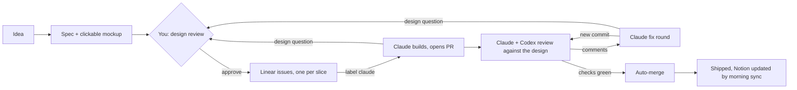

# idea-to-pr-loop

A template for running product work as a loop where your review happens early. Every feature, big or small, starts as a spec with a clickable mockup. You approve the two together, once, and Claude builds, reviews, fixes and merges the code. You never need to read a PR. ChatGPT Codex gives every PR a second, independent review.

It is a set of GitHub Actions workflows, a CLAUDE.md template, setup notes for Notion and Linear, and prompts for two scheduled Claude tasks. It is not a service: nothing runs outside your GitHub, Notion, Linear and Claude accounts.

## The loop

1. **Spec and mockup.** Ideas become specs in Notion. Claude writes each spec and makes a clickable mockup ([prompts/spec-and-mockup.md](prompts/spec-and-mockup.md)). Features with no screen get a preview of the behavior. Bug fixes that only restore approved behavior skip this.
2. **Design review.** You open the mockup, ask for changes, and approve. This is the only review you do.
3. **Cut into Linear issues.** One small slice per issue, each with acceptance criteria, the mockup link and a Design section describing what it builds.
4. **Build.** Labelling an issue `claude` syncs it to GitHub, and `claude.yml` builds it on a branch named after the Linear ID and opens a PR. Without an approved mockup link (or the `bug-fix` label) nothing is built.
5. **Review.** `claude-review.yml` reviews every ready PR and push against the issue and its design. Codex reviews the same PR through its own GitHub app.
6. **Fix.** `claude-fix.yml` answers the reviews: it fixes what it agrees with and replies with a reason where it doesn't. Security threads need a second Claude check before they close. One round per commit, at most three; then one fresh second attempt.
7. **Gate and merge.** The `Merge gate` status (posted by the review and fix jobs with `scripts/merge-gate.sh`) stays red while a design question is open, a review thread is unresolved, or the latest Claude review isn't "ready to merge". It is a required check, and GitHub auto-merge merges the PR once it and `check` pass.
8. **Report.** A daily task updates spec status in Notion, and a weekly task writes a retro.

### What still comes back to you

Only questions that need your judgment, and they come back to the spec's Design review, never as a PR to read:

1. The design or spec can't be built as approved.
2. A security fix would change approved behavior.
3. A hard-to-undo step the spec didn't name (deleting data, secrets, DNS or hosting settings, payments, launch switches). Name these in the spec and your approval covers them.

A second attempt that also runs out of fix rounds comes back as the first kind: the slice was cut wrong.

## What's in here

| Path | What it is |
|---|---|
| `.github/workflows/claude.yml` | Builds `claude`-labelled issues with an approved mockup into PRs and turns on auto-merge; answers `@claude` mentions |
| `.github/workflows/claude-review.yml` | Claude review against the design on each ready PR and push, ending in a verdict |
| `.github/workflows/claude-fix.yml` | Fix rounds after each review, the second security check, the second attempt and design questions |
| `.github/workflows/merge-gate.yml` | Updates the Merge gate when you remove `needs-human`, or on a manual re-run |
| `scripts/merge-gate.sh` | The Merge gate's checks, posted as a commit status |
| `.github/workflows/ci.yml` | Sample CI with a job named `check` |
| `scripts/check.sh` | Your install, lint, typecheck and test commands (fill this in) |
| `CLAUDE.md.template` | Rules Claude follows in the repo |
| `docs/` | Setup for Notion, Linear, GitHub, and the options |
| `prompts/` | Spec-and-mockup prompt, new-project prompt, morning sync, weekly retro |

## Setup checklist

1. Notion: create the four databases and the home page ([docs/notion.md](docs/notion.md)).
2. Linear: a team for the repo, labels `claude`, `needs-human` and `bug-fix`, GitHub Issues sync on ([docs/linear.md](docs/linear.md)).
3. GitHub: install the Claude and Codex apps, add the `CLAUDE_CODE_OAUTH_TOKEN` secret ([docs/github.md](docs/github.md)).
4. Copy the workflows, `scripts/check.sh` and `scripts/merge-gate.sh` into your repo, fill in `check.sh`, and rename `CLAUDE.md.template` to `CLAUDE.md` and fill it in. Or paste [prompts/new-project.md](prompts/new-project.md) into a new Claude project and let Claude do this step.
5. After the first PR runs CI, add the `protect main` ruleset with `check` and `Merge gate` required, then turn on auto-merge ([docs/github.md](docs/github.md#protect-main)).
6. Create the two scheduled tasks from [prompts/](prompts/).
7. Decide on attribution ([docs/options.md](docs/options.md)).

## Guardrails

- Claude never pushes to `main`; it works on branches and PRs, and the ruleset enforces it.
- Nothing is built without an approved mockup link, except a `bug-fix` that restores approved behavior.
- The fix job can edit, run `scripts/check.sh`, commit, push its own branch and comment. It cannot change labels, resolve threads or call the GitHub API; deterministic steps do that from files it writes.
- Review comments are treated as untrusted input, not instructions.
- The review marks security findings with `[security]`. A security thread is resolved only when a second, separate Claude check agrees it is fixed or a false alarm.
- At most one fix round per commit and three per attempt, and one second attempt. A design question adds `needs-human`, which keeps Merge gate red until the spec is approved again.
- PRs merge only through GitHub auto-merge with `check` and `Merge gate` required, so every check, every thread and the latest Claude verdict must be green.

## Cost

Everything runs on a Claude subscription (through `claude setup-token`) and a ChatGPT plan that includes Codex review; no API key is needed. All Claude use draws from the same subscription limits, so keep issues small, and expect to need a higher plan if several repos build at once.

## Requirements

- A Claude plan that includes Claude Code, and the Claude GitHub App.
- A ChatGPT plan with Codex code review (optional; without it, PRs get the Claude review only).
- Notion and Linear workspaces, connected to Claude for the scheduled tasks.
