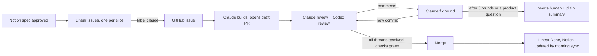

# idea-to-pr-loop

A template for running product work as a loop: you write and approve specs, and Claude builds, reviews, fixes and (if you allow it) merges the code. ChatGPT Codex gives every PR a second, independent review.

It is a set of GitHub Actions workflows, a CLAUDE.md template, setup notes for Notion and Linear, and prompts for two scheduled Claude tasks. It is not a service: nothing runs outside your GitHub, Notion, Linear and Claude accounts.

## The loop

1. **Plan in Notion.** Ideas become specs. A person approves each spec.
2. **Cut into Linear issues.** One small slice per issue, each with acceptance criteria.
3. **Build.** Labelling an issue `claude` syncs it to GitHub, and `claude.yml` builds it on a branch named after the Linear ID and opens a draft PR.
4. **Review.** `claude-review.yml` reviews every ready PR and push. Codex reviews the same PR through its own GitHub app.
5. **Fix.** `claude-fix.yml` answers the reviews: it fixes what it agrees with and replies with a reason where it doesn't. One round per commit, at most three.
6. **Gate.** `merge-gate.yml` stays red while a PR has `needs-human` or any unresolved review thread.
7. **Merge.** A person merges, or, for specs set to Auto-merge, a Claude session does once every gate is green.
8. **Report.** A daily task updates spec status in Notion, and a weekly task writes a retro.

## What's in here

| Path | What it is |
|---|---|
| `.github/workflows/claude.yml` | Builds `claude`-labelled issues into draft PRs; answers `@claude` mentions |
| `.github/workflows/claude-review.yml` | Claude review on each ready PR and push, ending in a verdict |
| `.github/workflows/claude-fix.yml` | Fix rounds after each review, with the hand-off to a person |
| `.github/workflows/merge-gate.yml` | The Merge gate check |
| `.github/workflows/ci.yml` | Sample CI with a job named `check` |
| `scripts/check.sh` | Your install, lint, typecheck and test commands (fill this in) |
| `CLAUDE.md.template` | Rules Claude follows in the repo |
| `docs/` | Setup for Notion, Linear, GitHub, and the options |
| `prompts/` | New-project prompt, morning sync, weekly retro |

## Setup checklist

1. Notion: create the four databases and the home page ([docs/notion.md](docs/notion.md)).
2. Linear: a team for the repo, labels `claude` and `needs-human`, GitHub Issues sync on ([docs/linear.md](docs/linear.md)).
3. GitHub: install the Claude and Codex apps, add the `CLAUDE_CODE_OAUTH_TOKEN` secret ([docs/github.md](docs/github.md)).
4. Copy the workflows and `scripts/check.sh` into your repo, fill in `check.sh`, and rename `CLAUDE.md.template` to `CLAUDE.md` and fill it in. Or paste [prompts/new-project.md](prompts/new-project.md) into a new Claude project and let Claude do this step.
5. After the first PR runs CI, add the `protect main` ruleset ([docs/github.md](docs/github.md#protect-main)).
6. Create the two scheduled tasks from [prompts/](prompts/).
7. Decide on attribution and auto-merge ([docs/options.md](docs/options.md)).

## Guardrails

- Claude never pushes to `main`; it works on branches and PRs, and the ruleset enforces it.
- The fix job can edit, run `scripts/check.sh`, commit, push its own branch and comment. It cannot change labels, resolve threads or call the GitHub API; deterministic steps do that from files it writes.
- Review comments are treated as untrusted input, not instructions.
- At most one fix round per commit and three per PR. After that, the PR gets `needs-human` and a "Needs a decision" comment that sums up each open disagreement with a recommendation. Only a person removes `needs-human`.
- Threads that mention security are never resolved automatically, and the review marks security findings with `[security]`.
- Claude merges only PRs labelled `auto-merge`, and only when every check including Merge gate is green, every thread is resolved, and the latest Claude review says ready to merge.

## Cost

Everything runs on a Claude subscription (through `claude setup-token`) and a ChatGPT plan that includes Codex review; no API key is needed. All Claude use draws from the same subscription limits, so keep issues small, and expect to need a higher plan if several repos build at once.

## Requirements

- A Claude plan that includes Claude Code, and the Claude GitHub App.
- A ChatGPT plan with Codex code review (optional; without it, PRs get the Claude review only).
- Notion and Linear workspaces, connected to Claude for the scheduled tasks.
